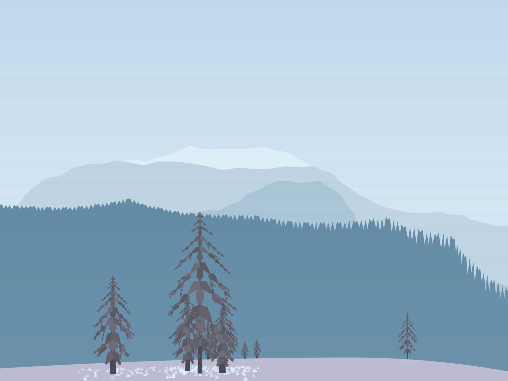

## BeautifulHash

|  |  |
|---|---|
| `aa6ed8c1b2283a48a64fca7f8be20b89e01fa378280f91c631ffe62c2f144534` | `ec6a17f8d540f175abe79b32907742efd2631a98d11df20ace953a4ff454379d` |

The project is to turn any input (strings, numbers, pdfs) into a beautiful,
distinctive, and repeatable landscape imagery in SVG format.

### Rationale

Many people want to use landscape images on their site, their office or even
living room at home.

However, what kinds of image do people prefer. They don't want templates
from shutterstock or bigbox retailers, but also something that is not too artisan.

As of late 2026, the landscape images from image-generation models still feel
"synthetic", "generated" and childish in some ways (also known as "slop"). This
could change in the future, but at the moment, I personally wouldn't use the 
LLM-generated images to hang on the wall.

### How BeautifulHash is Different

We are taking algorithmic and deterministic approach to drawing beautiful landscapes.
The quality control is done by me, who loves painting and drawing for fun on the
side. I will also incorporate feedback from users to improve the generation
algorithm (please see versioning below).

### How will Versioning work?

Unlike other repository the algorithm will be treated and develop like a protocol.
The updates will only be committed if the new version consistently produces higher
fidelity images across large distribution of seeds, without significant regressions.

Algorithm versions are named with a single integer: V0, V1, V2, and so on.

The cadence will also be significantly slower than other projects. V0 will
remain the default for at least 6 months, and subsequent versions will likely
remain the default for significantly longer than that.

There is always exactly one *default* version, which is what new artwork uses.
Every earlier version remains a *supported historical version*: once released,
it never changes and stays available, so any existing artwork can be regenerated
from its input and version. A new version becomes the default only when it is
clearly better, so most users never need to think about versions at all.

### What is the Input to the Algorithm

The BeautifulHash core accepts exactly 256 bits (32 bytes). External wrappers
convert arbitrary digital inputs into bytes and compute their SHA-256 digest
before invoking the generator. The input can be plain text (i.e. `string`),
numbers, pdf files, zip files, even images; a 32-byte hash can also be supplied
directly. The hash is then mapped to an image that depicts a beautiful landscape.

### Will each input have unique landscape

Strict uniqueness, where every SHA-256 hash maps to a different landscape, is a
design objective, not a guarantee. V0 aims to preserve all 256 bits of the hash
in its SVG output, which requires an injective hash-to-SVG mapping. The
Mountains, Hills, and Trees namespaces are designed to be injective, and
`make verify` checks this by decoding their bits back from rendered SVG text.
The remaining namespaces are not designed yet, and the mapping must
ultimately be proven rather than just tested (see collision considerations
below).

Separately, two different inputs are not guaranteed to produce different hashes,
although a SHA-256 collision would be an astronomically rare event.

#### Collision considerations

Even if the generator can represent at least $2^{256}$ different parameter combinations, that alone does not guarantee that all hashes map to different images.

The mapping must be injective to provide such a guarantee.

The number of available combinations and the uniqueness of the mapping are different mathematical questions.

### Current Status

The reference implementation in `core/` (C++17) draws seven of the eight
namespaces. Each is specified under `subspec/`:

| Namespace | Status |
|---|---|
| Mountains | Implemented: two or three layered ridges, biome styling (snow caps, conifer and canopy tree lines), and seasonal palettes |
| Hills | Implemented: one or two smooth hills below the mountains |
| Trees | Implemented, visual tuning in progress: 1 to 10 fractal trees per scene (conifers, deciduous trees with seasonal leaves, cacti, Joshua trees) |
| Fog | Implemented: an 8-bit haze (density, tint, ground mist) in every depth gap |
| Vegetation | Implemented: seasonal ground cover on the front hill (fallen leaves and snow pocks at the trees; petals, grass, and desert rosettes in the open) |
| Sky | Implemented: a sky tint and one cloud, a curved shape in a hash-shaped trapezoid, crisp on its leading side and dissolving elsewhere, as clear as the fog allows |
| Celestial | Implemented: an implicit, never-drawn sun that lights the front hill's bands and casts the trees' shadows |
| Global | Not yet implemented. Theme and season are fixed per gallery configuration until Global is built |

### Building

```sh
make              # build into build/
make verify       # quick checks (a tenth of full sampling); must print ALL CHECKS PASSED
make verify-full  # the same checks with 10x the samples, before releases
make gallery      # render gallery/index.html: every biome and season on the same hashes
```

The build needs only a C++17 compiler.

### Implementation Architecture

#### Proposed technology

| Component | Technology |
|---|---|
| Core scene generator | C++ |
| Browser compilation | WebAssembly |
| Website interface | TypeScript |
| Canonical artwork format | SVG |
| Preview rendering | SVG, optionally Canvas |
| Native generation | C++ executable |
| High-resolution export | SVG, or raster rendered from the SVG |

#### Core boundaries

The C++ generator should not depend on:

* Browser APIs
* DOM or Canvas
* Platform-specific random number generators
* System time
* Network access
* Operating-system locale
* Display resolution

Its responsibility is to produce a canonical scene description from an input hash.

#### Suggested API

```cpp
Scene generate_scene(Hash256 hash, Version version);

std::string render_svg(
    const Scene& scene,
    uint32_t width,
    uint32_t height
);
```

`generate_scene` is independent of resolution. `render_svg` takes the target
resolution as an explicit parameter (never the browser's display size) and
produces identical SVG bytes for identical arguments on every supported
platform. See the V0 compatibility guarantee in the specification.

### Versioning and Immutability

Every generated artwork is associated with an algorithm version.

Example:

```
BeautifulHash V0
SHA-256: <64-character hexadecimal hash>
```

Once V0 is frozen:

* PRNG behavior cannot change.
* Hash-to-scene mapping cannot change.
* Theme selection rules cannot change.
* Layer-generation algorithms cannot change.
* Default palettes and geometry rules cannot change.
* Scene serialization rules must remain compatible.

Bug fixes that alter scene output require a new algorithm version. The old
version stays available as a supported historical version.

Presentation-only changes may be made separately, but any change that alters the promised final visual output must be versioned.

### Verification

Before freezing V0, create golden test vectors.

Each test vector should include:

* Input (string, file bytes, or 32-byte hash) and the wrapper used
* SHA-256 digest
* Algorithm version
* Canonical scene digest
* Target resolution
* SHA-256 of the exact SVG output
* Reference raster rendering, if pixel reproducibility is required

Test categories should include:

* Direct 32-byte hashes (including all-zero and all-ones)
* Empty files
* Binary file inputs (e.g. images, PDFs, zip files)
* Empty string
* ASCII input
* Unicode input
* Korean characters
* Emoji
* Long strings
* Inputs differing by one character
* Optional-layer combinations
* Every environmental theme
* Several target resolutions for the same hash (composition must not change)

Native and WebAssembly builds must produce identical canonical scene digests and identical SVG hashes for the same test vectors.

### Open Design Decisions

The following remain unresolved and should not be treated as finalized V0 requirements:

* Unicode normalization policy for the string wrapper
* Theme-selection distribution
* Final tuning of the tree algorithms, and the vegetation algorithm
* Palette definitions
* Canonical scene serialization format
* Whether pixel-level uniqueness is required
* Whether pixel-identical rendering across platforms is required
* Final logical canvas dimensions
* Whether the first release includes print ordering

### V0 Completion Criteria

V0 is ready to freeze when:

* All four themes can produce aesthetically acceptable landscapes.
* All required and optional layers function.
* Identical inputs produce identical scenes.
* Native C++ and WebAssembly scene digests and SVG bytes match.
* Scene composition is independent of export resolution.
* Golden tests cover the core generator.
* The visual output has been reviewed across a representative sample of hashes.
* All algorithm-affecting implementation decisions are documented.

Guiding principle: BeautifulHash should produce artwork worth keeping, not merely demonstrate that SHA-256 can generate a large number of pictures.
